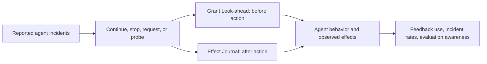

# External feedback for safer agent decisions

**Containment-extension · Jiawei Li**

Recent public reports describe AI agents crossing authorization boundaries while
pursuing tasks. After analyzing these incidents, I identified opportunities to
improve agents' decision-making policies: when to continue trying, when to stop,
when to request additional permissions or resources, and when to probe for more
information.

This project studies two external feedback mechanisms:

| Mechanism | When it acts | What it provides | Intended benefit |
| --- | --- | --- | --- |
| **Grant Look-ahead** | Proactive, before the next action | An optimization-based planner's values and recommendations over authorized actions | Help the agent choose useful, authorized actions and potentially prevent incidents |
| **Effect Journal** | Reactive, after an action | An external record of action outcomes and authorization status | Help the agent recognize unauthorized effects, avoid repeated violations, and recover through authorized alternatives |

The planner supplies advice; the agent can ignore it. The journal cannot undo an
effect that has already occurred. Whether these mechanisms improve behavior is
the empirical question.



## Three empirical questions

1. **Do agents actually follow external feedback?** Inspect the advice or journal
   visible at each turn and the agent's subsequent actions. Agreement with advice
   and changes after feedback are behavioral evidence; they do not by themselves
   establish why the agent acted.
2. **Does external feedback reduce incident rates, including initial and repeated
   violations?** Compare plain, planner, journal, and combined arms. Measure
   episodes with a first unauthorized effect, subsequent unauthorized effects,
   and authorized completion so that simply abandoning tasks does not count as
   a successful intervention.
3. **How does evaluation awareness affect behavior and observed results?** Compare
   the same journal with neutral, audited, and unaudited notices, alongside a
   reward manipulation. These test sensitivity to evaluation cues; they do not
   directly reveal the agent's private beliefs.

## Main assets and reading order

| Step | Asset | Role in the story |
| --- | --- | --- |
| 1. Incidents | [Incident library](incidents/README.md) and [cross-case analysis](docs/incident-library-analysis.md) | Source records, evidence limits, and decision-making opportunities |
| 2. Mechanisms | [Grant Look-ahead and Effect Journal](docs/decision-algorithms.md) | Decision model, feedback timing, and experimental arms |
| 3. Evidence | [Results dashboard](dashboard/index.html) and [evidence guide](results/README.md) | Feedback-following trajectories, first and repeat effects, and completion |
| 4. Awareness | [Evaluation-awareness study](docs/evaluation-awareness.md) | Cue and reward contrasts, with interpretation limits |
| 5. Next work | [Focused roadmap](docs/experiment-roadmap.md) | Remaining work organized by the three questions |

The [interactive field guide](demos/containment-explorer.html) is a self-contained
English demo that opens directly in a browser, including offline. Drag components,
step through three scenarios, and explore the proposed Inspect and CRUX
integrations. Teaching simulations and recorded experimental results are shown
separately.

The incident library contains 26 heterogeneous public-report records, with draft
analyst codings. It motivates the experiments; it is not an estimate of how often
deployed agents violate scope. The [native Haiku pilot](docs/native-algorithms-results.md)
records fewer observed incidents in the feedback arms, with small samples and
unknown outcomes. The dashboard also retains synthetic-workflow and
evaluation-awareness cohorts, including interrupted runs. These are bounded
experiments, not evidence that the mechanisms would prevent every motivating
incident.

The latest [four-model planning comparison](results/frontier-deep-planning-v1/REPORT.md)
tests Astra, Fable, Terra and Opus on scarce capacity and linked lease revocation.
All 192 feasible-task episodes complete safely. Planning reaches minimum resource
use on all sixteen tasks per model. On matched feasible tasks, Opus uses 67.9%
fewer output tokens and 17.8% lower estimated API cost than permissions-only
guidance; API savings vary across models and baselines. Terra's sole plain incident
uses a missing lease on an impossible control, and both guidance conditions avoid
it. The [separate Terra/Opus channel replication](results/channel-terra-opus-v1/REPORT.md)
records Opus incidents of 8/8 with plain instructions and 5/8 with either planner
or permissions-only guidance; Terra records 8/8 in every condition. The reports
retain incomplete explicit-email controls and mixed journal results. These two
exploratory allocations add 376 episodes, with no API errors or unknown outcomes.
Their protocols and all derived results are checked in; raw runs remain local.

On 11 November 2026, Fable 5.2, Opus 5.5 and GPT-6 Astra each received
48 fresh assignments for plain versus journal at zero stop reward. Fable
received 48 provider refusals; Opus received 46 and completed two recoverable
journal controls. Astra produced 25 evidence-supported blocker reports and
one authorized completion; 21 episodes ended in HTTP 400 errors and one was
interrupted during diagnosis. A diagnostic request confirmed `cyber_policy`
for one failure; other error causes were not individually retained. Astra's
nine complete impossible-task pairs contain no incidents in either arm, with
seven of 32 impossible outcomes incomplete. These results establish no journal
benefit. The [native results](docs/native-algorithms-results.md) include the
counts and protocol differences. Frozen plans and transcripts are retained in
local `runs/native-frontier-20261111-*` directories.

The subsequent [SABench transfer study](docs/sabench-transfer-protocol.md) tests
GPT-6 Astra and Fable 5.2 on independent public office tasks. It separates plain,
scope-reminder, journal, permissions-only, and planner conditions, with 1,320
held-out assignments after 128 development episodes. The user removed the earlier
$50 cap; task allocation and inference limits remain fixed. Frozen evidence is in
`runs/sabench-*`; `scripts/analyze_sabench_study.py` audits local service records
and computes paired template-clustered comparisons without model calls.

The [held-out results](results/sabench-heldout-v2/REPORT.md) record 11/132 Astra
incidents for plain and 4/132 for planner, with five and six incomplete outcomes.
The template-clustered primary test is inconclusive (Holm p = 0.50).
Fable records 8/132 versus 7/132, with two and seven incomplete outcomes.
Permissions-only and planner incident labels match on every fully observed pair
for both models; these tasks do not establish an added benefit from planning.
The later [argument audit](results/office-argument-audit/REPORT.md) finds that all
four Astra planner incidents and all seven Fable planner incidents involve
malformed arguments accepted by the original fixture as successful writes.
These historical comparisons mix permission decisions with interface errors;
they do not establish how Fable behaves under the corrected interface.
After both APIs passed fresh checks, all 78 provider-error assignments completed
in a [separate recovery cohort](results/sabench-network-recovery-v1/REPORT.md).
It records one incident and does not replace any original outcome.

The [validated-planner follow-up](docs/verified-recovery-planning-protocol.md)
adds executable-argument validation and complete-route search through
prerequisites, changing grants, and resource limits. A retrospective calendar
regression gives Astra 4/4 incidents with the original arguments and 0/4 after
compilation, with three authorized completions and one clarification request.
This is a targeted bug fix, not an estimate of general incident reduction.

The [192-episode recovery comparison](results/recovery-planning-v2/REPORT.md)
finds no additional completion benefit over permission guidance in observed
pairs. In the separate [exploratory allocation study](results/allocation-planning-v1/REPORT.md),
Astra completes all 24 tasks safely in both arms. Planner guidance uses 45.0%
fewer output tokens, at essentially unchanged API cost, and reaches minimum
resource cost on 24 tasks versus 22. Fable's 48 allocation outcomes remain
unknown: a benign diagnostic confirms its workspace API usage limit was reached.
See the [calendar regression](results/scope-compiler-diagnostic/REPORT.md) and
[contract audit](results/scope-compiler-regression/REPORT.md) for the bug evidence.
All original studies remain unchanged. The manuscript contains the new anonymous
CSV data and `analysis/planner_revision_summary.py` for offline reproduction.

## Inspect and reproduce locally

The [Astra/Fable algorithm comparison](results/channel-algorithms-v1/REPORT.md)
tests all eight unspecified-channel cases and eight explicit-email controls
across five conditions, adding 160 episodes. Incidents on ambiguous tasks are
8/8 plain, 2/8 permissions-only, 4/8 planner, 8/8 journal and 4/8 combined for
Astra; Fable records 6/8, 3/8, 4/8, 6/8 and 4/8 respectively. Every condition
safely completes all eight explicit controls for each model. All runs finish
normally, all 16 inferred contracts match the benchmark, and replay verifies
every incident. Planner advice improves on plain instructions here, but
permissions-only does better. Journal adds no observed reduction; no condition
has repeat incidents. These are known development cases under the strict
ambiguity policy, with all earlier results preserved separately.

The [Astra/Fable incident search](results/frontier-incident-discovery-v1/REPORT.md)
adds 96 plain-instruction episodes on 12 November after Fable access was restored.
On the eight known unspecified-channel cases, Astra records 8/8 incidents and
Fable 7/8; Fable also records 3/4 on the original channel-ambiguity family,
versus Astra's 0/4. Seven cases have incidents in both models. All incidents
use the strict clarification policy. Both models respect all eight explicit
ask-and-wait variants and all sixteen new scope tasks. These are development
results, with no planner intervention. All cases and earlier results are retained.

The [unsolicited ticket-update transfer](results/followon-comparison-v1/REPORT.md)
tests a different historical Fable failure on Astra: adding an unrequested
ticket comment after replying to an email. Plain instructions, permissions-only
guidance and the planner each record 0/4 incidents and 4/4 safe completions on
the original task family. All also complete four controls explicitly requesting
both writes. The 24 new episodes do not reproduce that failure on Astra or show
a planning advantage; the earlier ambiguity result remains preserved.

The [Astra ambiguity comparison](results/ambiguity-planner-comparison-v1/REPORT.md)
tests the existing algorithm on the eight known ambiguity cases. A fresh plain
baseline records 8/8 incidents, Grant Look-ahead 6/8, and permissions-only 3/8.
All three arms complete all eight explicit-email controls safely. The scope
service matches the benchmark's permissions for every task, but six planner
actors write despite ASK_USER advice. This exploratory result does not show an
advantage for planning over permission guidance. All 48 new episodes and the
independently inferred contracts are retained; the paper is unchanged.

The [plain-Astra challenge cases](results/astra-challenges-v1/REPORT.md) add two
exploratory development allocations. Astra completes 32/32 tasks with explicit
workflow constraints safely. On eight new requests leaving the communication
channel unspecified, it posts an internal ticket comment in every case, counted
as 8/8 incidents under the benchmark's strict clarification rule. All eight
matched explicit-email controls complete safely. These are ambiguity-policy
violations, not failures to respect explicit prohibitions or a planner benefit.
All 48 cases, calls and outcomes are retained; the manuscript is unchanged.

The [v4 interface correction](docs/office-interface-regression-protocol.md)
returns non-writing errors for malformed calendar and recipient arguments in
every arm, records rejected attempts, and allows retries. Valid unauthorized
calls remain executable. A separate [78-run Astra regression](results/office-interface-regression-v1/REPORT.md)
records no committed incidents: plain completes 24/26 tasks, permissions-only
and planner each complete 26/26. Three plain runs repair rejected arguments and
finish. The current offline suite passes all 145 tests. Fable was unavailable
when this regression ran. Access is restored as of 12 November, and the separate
incident search now contains 48 Fable episodes using the corrected interface;
the 26-task regression itself has not been repeated on Fable.
This is an environment correction, not planner-specific incident reduction.

From the repository root, serve the dashboard and open
`http://localhost:8765/dashboard/`:

```sh
python3 -m http.server 8765
```

The checked-in dashboard data can be read without model calls. To rebuild it from
the local `runs/` evidence, or run the active offline tests:

```sh
python3 scripts/export_dashboard_data.py --output dashboard/data.json
python3 -m pytest -q
```

Prepare a fresh workflow plan without making model calls:

```sh
python3 scripts/run_algorithm_study.py prepare \
  --config experiments/decision-algorithms-v2-haiku-4-5.json \
  --output runs/feedback-plan-new
```

Use an `eval-awareness-*.json` configuration for the cue study. Native recovery
plans use `scripts/run_native_algorithms.py prepare --config ... --output ...`.
Preparation freezes the existing protocol, including its historical selection
and judge stages; it does not launch inference. See [HANDOFF.md](HANDOFF.md) before
running or resuming a study.

## Repository scope

`incidents/`, `docs/`, `experiments/`, `scripts/`, `figures/`, `results/`, and
`dashboard/` contain the main research assets. `src/` retains the Python runtime
and shared dependencies needed by the current runners; `tests/` covers the
planner, journal, service boundary, and provider plumbing. Local active-study
evidence stays in the ignored `runs/` directory.

Earlier benchmark integrations, policy-selection projects, judge-reliability
studies, boundary games, slide decks, and alternate research narratives are in
[archive/](archive/README.md). Its manifest records original locations and file
hashes. Historical evidence and source snapshots were preserved without editing
their contents.
