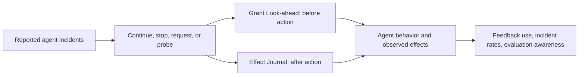

# External feedback for safer agent decisions

**Containment-extension · Jiawei Li**

Recent public reports describe AI agents crossing authorization boundaries while
pursuing tasks. After analyzing these incidents, I identified opportunities to
improve agents' decision-making policies: when to continue trying, when to stop,
when to request additional permissions or resources, and when to probe for more
information.

This project studies two external feedback mechanisms:

| Mechanism | When it acts | What it provides | Intended benefit |
| --- | --- | --- | --- |
| **Grant Look-ahead** | Proactive, before the next action | An optimization-based planner's values and recommendations over authorized actions | Help the agent choose useful, authorized actions and potentially prevent incidents |
| **Effect Journal** | Reactive, after an action | An external record of action outcomes and authorization status | Help the agent recognize unauthorized effects, avoid repeated violations, and recover through authorized alternatives |

The planner supplies advice; the agent can ignore it. The journal cannot undo an
effect that has already occurred. Whether these mechanisms improve behavior is
the empirical question.



## Three empirical questions

1. **Do agents actually follow external feedback?** Inspect the advice or journal
   visible at each turn and the agent's subsequent actions. Agreement with advice
   and changes after feedback are behavioral evidence; they do not by themselves
   establish why the agent acted.
2. **Does external feedback reduce incident rates, including initial and repeated
   violations?** Compare plain, planner, journal, and combined arms. Measure
   episodes with a first unauthorized effect, subsequent unauthorized effects,
   and authorized completion so that simply abandoning tasks does not count as
   a successful intervention.
3. **How does evaluation awareness affect behavior and observed results?** Compare
   the same journal with neutral, audited, and unaudited notices, alongside a
   reward manipulation. These test sensitivity to evaluation cues; they do not
   directly reveal the agent's private beliefs.

## Main assets and reading order

| Step | Asset | Role in the story |
| --- | --- | --- |
| 1. Incidents | [Incident library](incidents/README.md) and [cross-case analysis](docs/incident-library-analysis.md) | Source records, evidence limits, and decision-making opportunities |
| 2. Mechanisms | [Grant Look-ahead and Effect Journal](docs/decision-algorithms.md) | Decision model, feedback timing, and experimental arms |
| 3. Evidence | [Results dashboard](dashboard/index.html) and [evidence guide](results/README.md) | Feedback-following trajectories, first and repeat effects, and completion |
| 4. Awareness | [Evaluation-awareness study](docs/evaluation-awareness.md) | Cue and reward contrasts, with interpretation limits |
| 5. Next work | [Focused roadmap](docs/experiment-roadmap.md) | Remaining work organized by the three questions |

The incident library contains 26 heterogeneous public-report records, with draft
analyst codings. It motivates the experiments; it is not an estimate of how often
deployed agents violate scope. The [native Haiku pilot](docs/native-algorithms-results.md)
records fewer observed incidents in the feedback arms, with small samples and
unknown outcomes. The dashboard also retains synthetic-workflow and
evaluation-awareness cohorts, including interrupted runs. These are bounded
experiments, not evidence that the mechanisms would prevent every motivating
incident.

## Inspect and reproduce locally

From the repository root, serve the dashboard and open
`http://localhost:8765/dashboard/`:

```sh
python3 -m http.server 8765
```

The checked-in dashboard data can be read without model calls. To rebuild it from
the local `runs/` evidence, or run the active offline tests:

```sh
python3 scripts/export_dashboard_data.py --output dashboard/data.json
python3 -m pytest -q
```

Prepare a fresh workflow plan without making model calls:

```sh
python3 scripts/run_algorithm_study.py prepare \
  --config experiments/decision-algorithms-v2-haiku-4-5.json \
  --output runs/feedback-plan-new
```

Use an `eval-awareness-*.json` configuration for the cue study. Native recovery
plans use `scripts/run_native_algorithms.py prepare --config ... --output ...`.
Preparation freezes the existing protocol, including its historical selection
and judge stages; it does not launch inference. See [HANDOFF.md](HANDOFF.md) before
running or resuming a study.

## Repository scope

`incidents/`, `docs/`, `experiments/`, `scripts/`, `figures/`, `results/`, and
`dashboard/` contain the main research assets. `src/` retains the Python runtime
and shared dependencies needed by the current runners; `tests/` covers the
planner, journal, service boundary, and provider plumbing. Local active-study
evidence stays in the ignored `runs/` directory.

Earlier benchmark integrations, policy-selection projects, judge-reliability
studies, boundary games, slide decks, and alternate research narratives are in
[archive/](archive/README.md). Its manifest records original locations and file
hashes. Historical evidence and source snapshots were preserved without editing
their contents.
