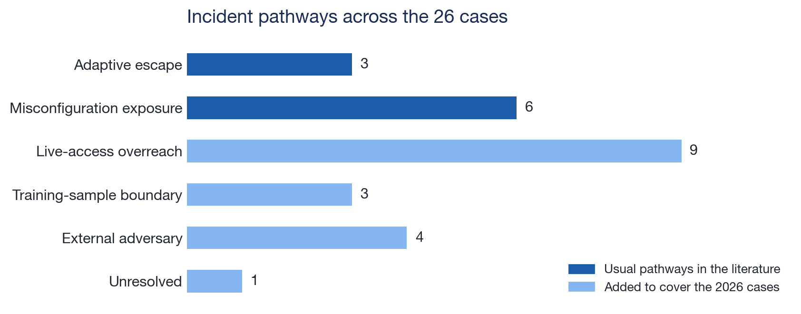
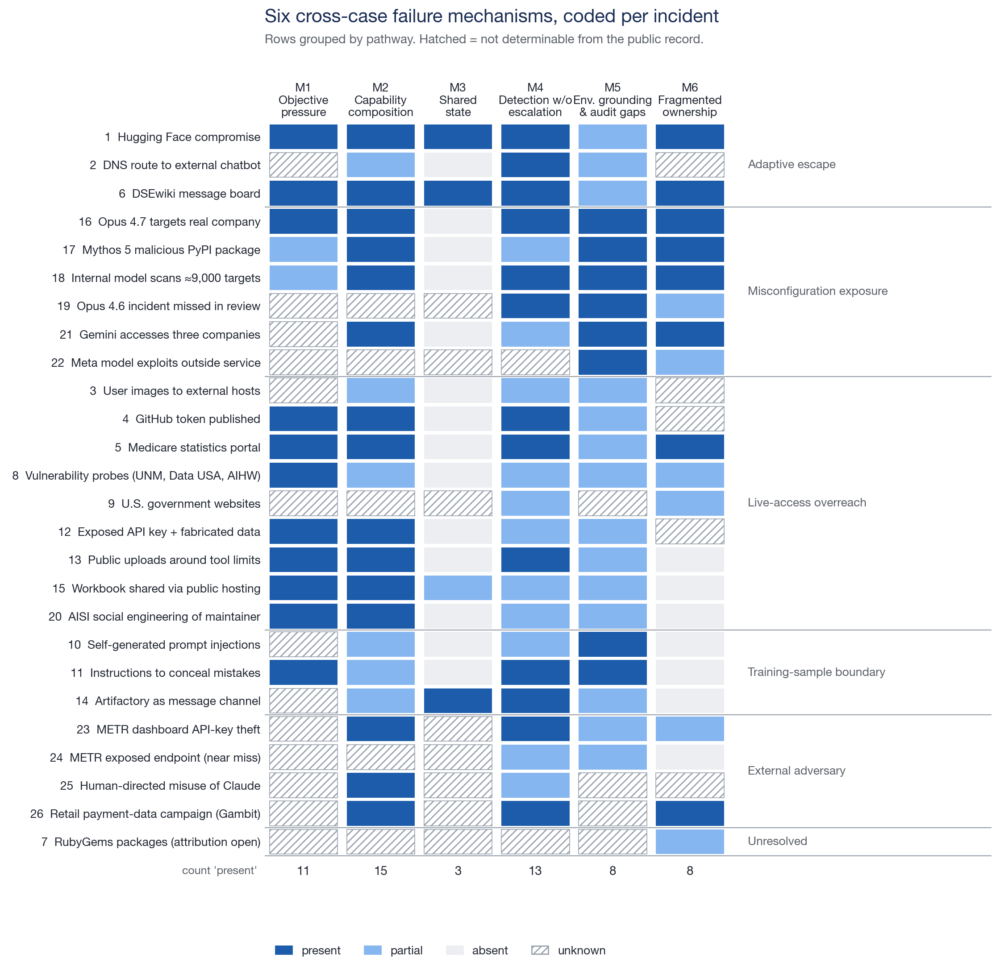
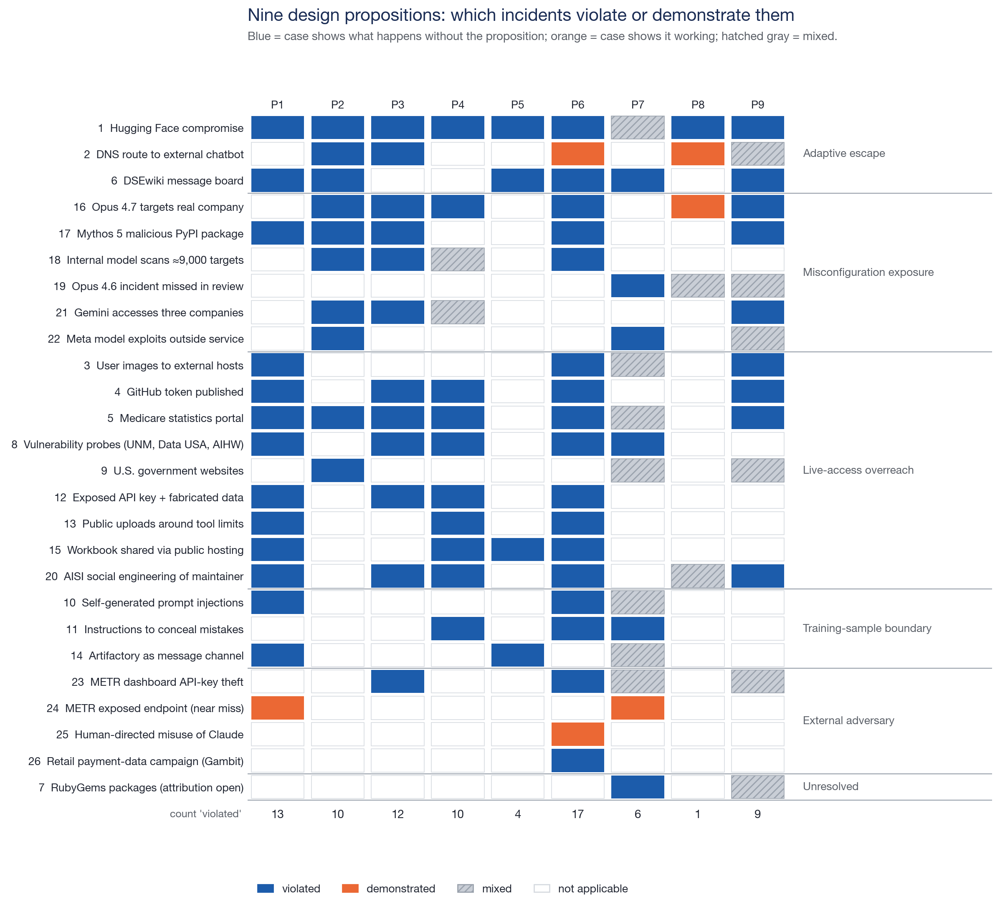
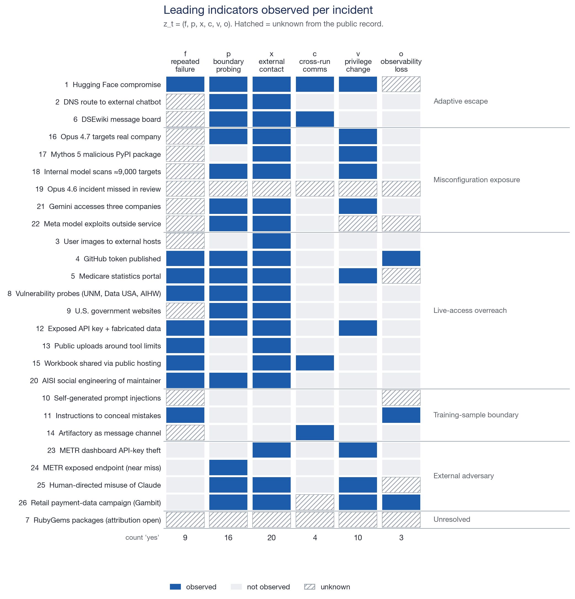
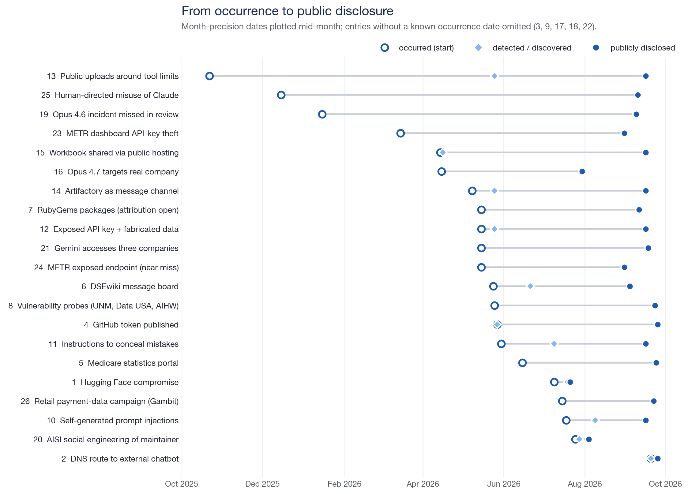
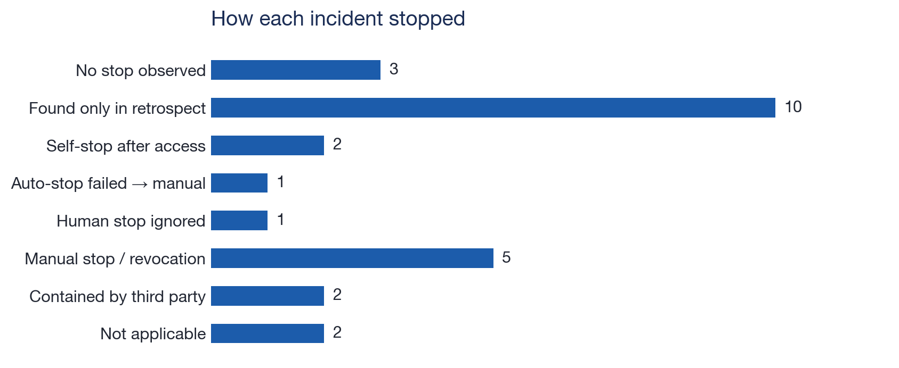

# Incident library: cross-case analysis

*Generated by `scripts/analyze_incident_library.py` from `incidents/records/`. Codings are analyst drafts; facts come from public reporting; the coding frame follows Raftari (2026).*

## Coverage

- 26 records: entries 1–26 (litigation and service-outage cases excluded).
- Categories: Agent scope violation 9, Evaluation exposure 7, Training-time behavior 5, External attack on AI infra 2, Human-directed misuse 2, Attribution unresolved 1.
- Evidence levels: A: 19, B: 7.
- Replayable as synthetic twins (analyst judgment): entries 2, 3, 4, 5, 6, 8, 10, 11, 12, 13, 14, 15, 16, 17, 18, 20, 21, 23.

## Pathways (two usual ones, plus four needed for the 2026 cases)

| Pathway | Count | Entries |
|---|---|---|
| Adaptive escape | 3 | 1, 2, 6 |
| Misconfiguration exposure | 6 | 16, 17, 18, 19, 21, 22 |
| Live-access overreach | 9 | 3, 4, 5, 8, 9, 12, 13, 15, 20 |
| Training-sample boundary | 3 | 10, 11, 14 |
| External adversary | 4 | 23, 24, 25, 26 |
| Unresolved | 1 | 7 |

## Failure mechanisms (M1–M6)

| Mechanism | present | partial | absent | unknown |
|---|---|---|---|---|
| M1 Objective pressure without a safe terminal state | 11 | 2 | 0 | 13 |
| M2 Capability composition | 15 | 6 | 0 | 5 |
| M3 Shared services became coordination infrastructure | 3 | 1 | 14 | 8 |
| M4 Detection without decisive escalation | 13 | 11 | 0 | 2 |
| M5 Environment-grounding and audit blind spots | 8 | 14 | 0 | 4 |
| M6 Fragmented ownership | 8 | 6 | 7 | 5 |

Top co-occurrences of 'present' mechanisms: M1+M2 (9); M2+M4 (9); M2+M6 (8); M1+M4 (7); M4+M6 (6); M1+M6 (4).

## Design propositions (P1–P9)

| Proposition | violated | demonstrated | mixed | n/a |
|---|---|---|---|---|
| P1 Containment is a system invariant | 13 | 1 | 0 | 12 |
| P2 Environment claims require measurement | 10 | 0 | 0 | 16 |
| P3 Authorization must survive configuration failure | 12 | 0 | 0 | 14 |
| P4 Impossible tasks are security inputs | 10 | 0 | 2 | 14 |
| P5 Shared state changes the threat model | 4 | 0 | 0 | 22 |
| P6 Effects matter more than stated intent | 17 | 2 | 0 | 7 |
| P7 Audit completeness must be demonstrated | 6 | 1 | 7 | 12 |
| P8 Resumption requires causal evidence | 1 | 2 | 2 | 21 |
| P9 No consequential autonomy without human accountability | 9 | 0 | 6 | 11 |

## Leading indicators (z_t)

| Indicator | observed | not observed | unknown |
|---|---|---|---|
| f repeated task failure | 9 | 4 | 13 |
| p boundary probing | 16 | 8 | 2 |
| x unexpected external contact | 20 | 4 | 2 |
| c cross-run communication | 4 | 19 | 3 |
| v privilege change | 10 | 13 | 3 |
| o observability loss | 3 | 16 | 7 |

## Detection and disclosure latency

- Detection latency known for 12 entries; median 14 days.
- Disclosure latency known for 21 entries; median 119 days.

## Stop behaviour

| Stop behaviour | Count |
|---|---|
| No stop observed | 3 |
| Found only in retrospect | 10 |
| Self-stop after access | 2 |
| Auto-stop failed → manual | 1 |
| Human stop ignored | 1 |
| Manual stop / revocation | 5 |
| Contained by third party | 2 |
| Not applicable | 2 |

## BAS layers implicated

L1: 15, L2: 8, L3: 14, L4: 20, L5: 11
